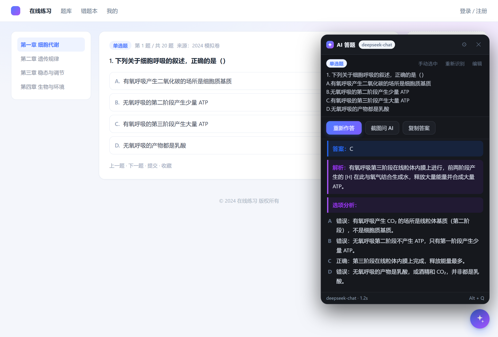
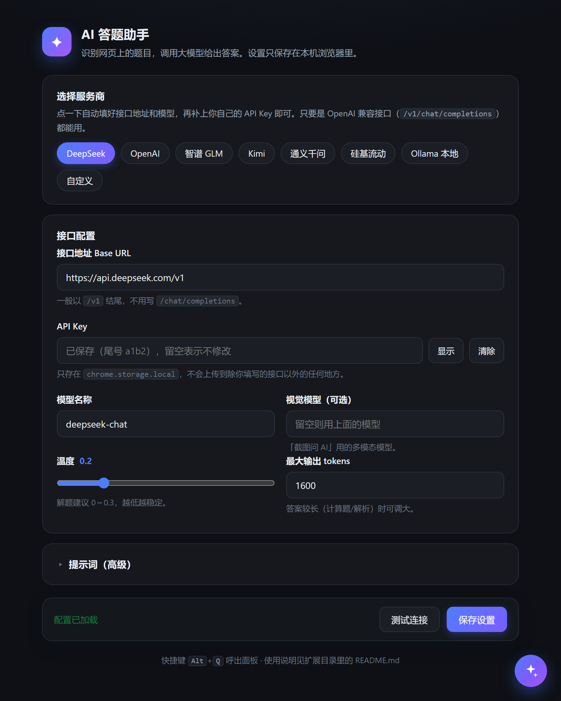
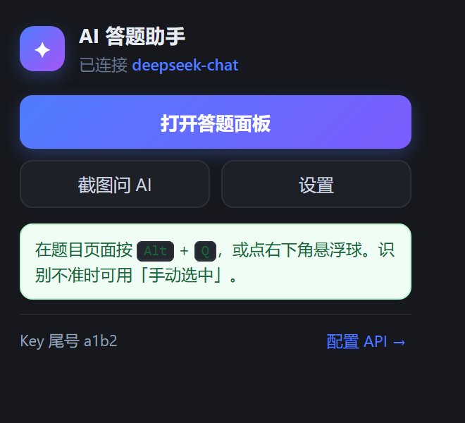
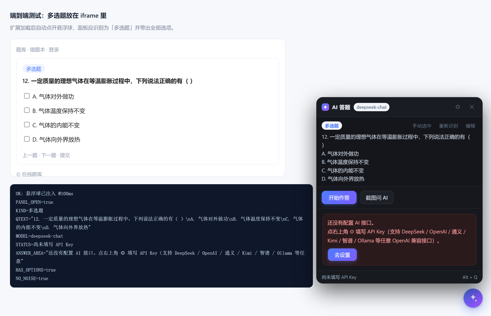

# ai-answer-helper（AI 答题助手）

在任意网页上一键识别题目，调用大模型给出**答案、解析和逐项分析**。纯前端扩展，不需要服务器。



## 功能

| 能力 | 说明 |
| --- | --- |
| 一键识别题目 | 页面右下角悬浮球、快捷键 `Alt + Q`、或工具栏图标 |
| 题型自动识别 | 单选 / 多选 / 判断 / 填空 / 简答；认错了就点一下面板上的题型标签手动切换 |
| 任意 OpenAI 兼容接口 | DeepSeek、OpenAI、通义千问、Kimi、智谱 GLM、硅基流动、Ollama 本地… |
| 流式输出 | 答案逐字出现，可随时「停止」 |
| 跨 iframe 取题 | 学习通等把题目放在 iframe 里的站点也能识别 |
| 手动选中 | 自动识别不准时，点「手动选中」在页面上框选题目区域 |
| 截图问 AI | 图片题、公式题交给视觉模型（需配置多模态模型） |
| 编辑题目 | 抓到的文字有噪音时，可直接在面板里改完再问 |
| 复制答案 | 一键复制，方便整理到笔记 |

## 下载安装

**[⬇ 下载最新安装包（.zip）](https://github.com/crane-you/ai-answer-helper/releases/latest)** — 解压后按下面的步骤加载，不需要安装任何开发工具。

也可以直接 clone 本仓库，把仓库根目录当扩展加载（内容与安装包一致）。

## 安装

1. 打开 Edge，地址栏访问 `edge://extensions/`
2. 打开左下角（或右侧）的 **开发人员模式**
3. 点击 **加载解压缩的扩展**，选择本文件夹（就是含 `manifest.json` 的那一层目录）
4. 安装成功后会自动打开设置页

> Chrome 一样可用：`chrome://extensions` → 开发者模式 → 加载已解压的扩展程序 → 选择本文件夹。
>
> 想发布到应用商店？打包与提交步骤见 [STORE.md](STORE.md)。

## 配置 API

安装后首次会自动打开设置页，也可以随时点扩展图标 → 「设置」。



点一下服务商按钮会自动填好接口地址和模型，**只需要补上你自己的 API Key**。

| 服务商 | Base URL | 默认模型 | 支持图片 |
| --- | --- | --- | --- |
| DeepSeek | `https://api.deepseek.com/v1` | `deepseek-chat` | 否 |
| OpenAI | `https://api.openai.com/v1` | `gpt-4o-mini` | 是 |
| 智谱 GLM | `https://open.bigmodel.cn/api/paas/v4` | `glm-4-flash` | 是 |
| Kimi | `https://api.moonshot.cn/v1` | `moonshot-v1-8k` | 是 |
| 通义千问 | `https://dashscope.aliyuncs.com/compatible-mode/v1` | `qwen-plus` | 是 |
| 硅基流动 | `https://api.siliconflow.cn/v1` | `Qwen/Qwen2.5-7B-Instruct` | 是 |
| Ollama 本地 | `http://localhost:11434/v1` | `qwen2.5:7b` | 视模型而定 |

以 DeepSeek 为例：

1. 到 [platform.deepseek.com](https://platform.deepseek.com) 创建 API Key
2. 设置页点 **DeepSeek** → 把 Key 粘贴到「API Key」→ **保存设置**
3. 点 **测试连接**，看到「连接成功 ✓」就可以了

> 任何符合 OpenAI 规范的 `/chat/completions` 接口都能用：把 Base URL 填成以 `/v1` 结尾的地址即可。

## 使用

1. 打开任意有题目的页面（在线题库、作业、练习卷…）
2. 按 `Alt + Q`，或点右下角悬浮球，或点扩展图标 →「打开答题面板」
3. 面板会自动显示识别到的题目，点 **开始作答**
4. 需要复制时点 **复制答案**

识别不准时：

- 点 **手动选中**，再在页面上点一下题干（会连带把选项一起抓出来）
- 或点 **编辑**，直接修改文本
- 题目是图片时，点 **截图问 AI**（需在设置里填支持视觉的模型）



## 工作方式

- `lib/extract.js` 在页面里给所有文本块打分：是否含选项字母、是否有题干特征词、是否在可视区、是否是导航/广告/评论区域……取分数最高的块，再按需要收缩或扩张到刚好包住「题干 + 选项」。
- 多 frame 页面会同时扫描所有 frame，取分数最高的那个，所以题目在 iframe 里也能读到。
- 请求由后台 Service Worker 发起（避免页面 CSP / 跨域限制），通过 SSE 逐字回传。

## 隐私

- API Key 只保存在本机 `chrome.storage.local`，不会上传到除你填写的接口地址以外的任何地方。
- 题目文本只发送到你在设置里配置的那个接口。
- 没有统计上报、没有账号体系、不收集浏览历史。
- 完整说明（包括权限用途与残余风险）见 [PRIVACY.md](PRIVACY.md)。

## 常见问题

**多选题被当成单选题**
扩展会依次看：页面上写的题型标签、选项前的复选框、小节标题（如「二、多选题」），多数站点能自动判对。如果还是判错，点一下面板左上角的题型标签即可切到「多选题」，再点「开始作答」——这个切换会一起告诉模型，答案就不会只给一个字母了。



**提示「API Key 无效」**
检查 Key 是否复制完整、是否与当前服务商匹配（不同厂商的 Key 不能混用）。

**提示「接口地址或模型名称不对」**
Base URL 一般要以 `/v1` 结尾（智谱是 `/api/paas/v4`），并确认模型名拼写正确。

**请求失败 / 一直转圈**
多为网络问题。可先用设置页的「测试连接」排查：连不上就是网络或代理问题，该接口可能需要能直连外网。

**悬着球挡住了页面按钮**
按住悬浮球可以拖到别的位置，位置会被记住。

**快捷键没反应**
`Alt + Q` 可能被其他扩展占用。到 `edge://extensions/shortcuts` 里改成别的组合。

**某些网站不显示悬浮球**
浏览器内置页面（`edge://`、应用商店等）不允许注入脚本，这是浏览器限制。

**图片题答不出来**
当前模型不支持图片输入。到设置里把「视觉模型」填成多模态模型，例如 `gpt-4o-mini`、`glm-4v-flash`、`qwen-vl-plus`。

## 目录结构

```
ai-qa-extension/
├─ manifest.json          # MV3 清单
├─ background.js          # Service Worker：调接口、流式转发、跨 frame 取题、截图
├─ lib/extract.js         # 题目识别（纯逻辑，可单独测试）
├─ content/content.js     # 悬浮球 + 面板 UI + 手动框选
├─ popup/                 # 工具栏弹窗
├─ options/               # 设置页
├─ assets/                # 图标
├─ docs/                  # 截图与 CI 配置
├─ demo/preview.html      # 界面预览（不连网络，模拟流式回答）
├─ test/                  # 自测页面：识别 / XSS / 端到端
└─ tools/                 # 图标生成、自测脚本
```

## 开发与自测

```bash
# 识别逻辑自测（需要浏览器）：打开 test/extract-test.html，或
bash tools/run-browser-tests.sh      # 无头浏览器跑 11 项识别断言 + 出截图

# 后台逻辑自测（Node，自带假 OpenAI 服务）
node test/background-test.mjs

# 回答渲染的 XSS 防护测试（浏览器打开，标题出现 XSS-SAFE 即通过）
# test/xss-test.html

# 端到端：真实加载扩展，验证注入 / 跨 frame 取题 / 面板联动
bash tools/run-e2e.sh
```

> 无头 Chromium 需要命名管道，在受限沙箱里跑不起来；这些脚本要在普通终端执行。
> 脚本会自动查找 Chrome / Edge，找不到时用 `EDGE_PATH="/path/to/msedge"` 指定。
> 想开 CI 的话，把 `docs/ci.yml` 复制到 `.github/workflows/ci.yml` 即可（推送 workflow 文件要求 token 具备 `workflow` 权限）。

## 说明

本项目用于学习与核对答案。请遵守你所访问网站的使用规则，不要把工具用于考试作弊等违反规则的场景。

以 [MIT 许可证](LICENSE) 开源。